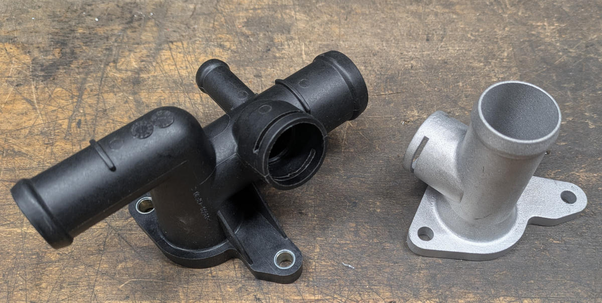
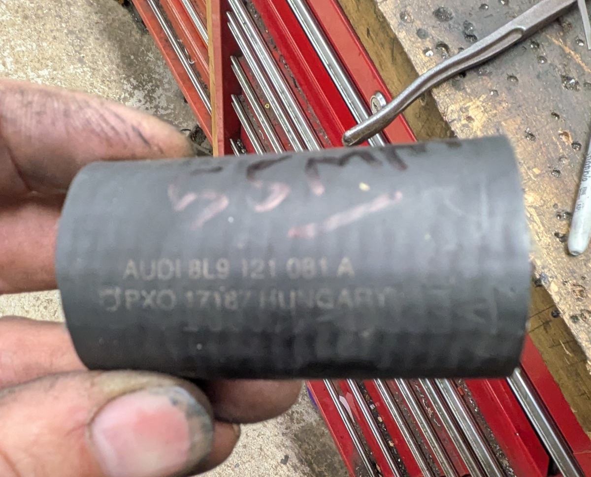
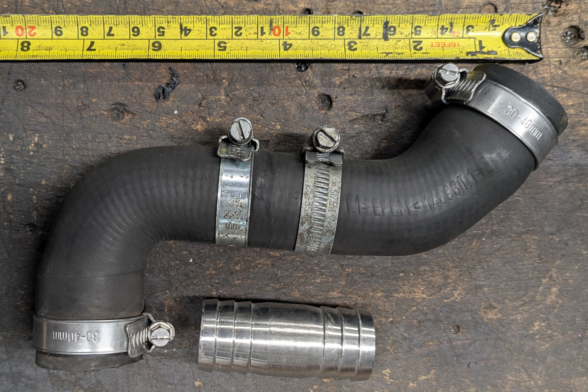

The coolant hoses are very simple as everything is in a similar location. BUT the top hose 1.8T plastic flange adapter on the head points in the wrong direction.

This folder contains the 3d cad model https://github.com/threepotMR2/OpenBAM/blob/main/Coolant_Hoses_Adapter/coolant%20outlet_flange%20rotate%20last%20slimmer.STEP so you can get this cool one 3d printed in alloy etc using website such as  http://craftcloud3d.com or https://app.prototi.com/     ProtoTi seem to be the cheapest at the moment being around $30 plus $10 shipping. With this cool adapter, the stock MR2 Hose just fits like an OEM job!

The bottom front hose is easily made from one of the Audi TT Hoses, the hose that works is 8L9121081A which you cut 55mm out of the middle of it and rejoin with straight coupler 28mm diameter by 65mm long.
You will find this coupler on amazon prime etc as "28x68mm hose barb equal pipe fitting". https://www.amazon.co.uk/dp/B0DX26VK1G

